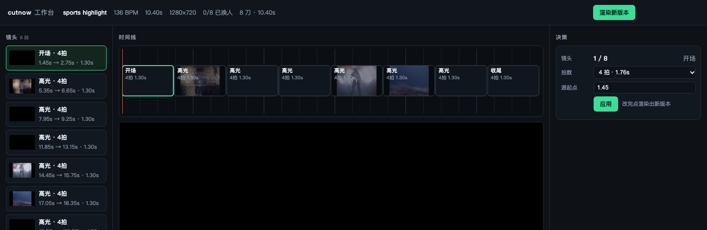

<div align="center">

# cutnow

**A deterministic editing engine that agents can drive and humans can audit.**

[](https://github.com/jchen0102/cutnow/actions/workflows/ci.yml)
[](https://pypi.org/project/cutnow/)
[](https://pypi.org/project/cutnow/)
[](LICENSE)

[中文](README.zh-CN.md) · [Docs](docs/) · [Examples](solutions/)

</div>


```bash
pip install cutnow
cutnow doctor
cutnow run sports --source match.mp4 --out highlight.mp4
```

That is a 10-second vertical-ready highlight cut on the beat, with title and end cards baked in —
no timeline app, no render queue, no manual keyframes.

---

## Why not "one-click AI video"?

Most tools give you a **finished file**. You cannot change one cut without starting over, and you
cannot ask *why* that cut is there.

cutnow gives you an **edit decision list (EDL)** — a plain JSON timeline you can read, diff and
rewrite — plus the engine that turns it into a video, byte-for-byte reproducibly.

| Typical tool | cutnow |
|---|---|
| "AI edited your video" | every cut has a score and a reason |
| change = re-generate everything | change one line, re-render in seconds |
| one workflow per product | a new recipe is a JSON file, engine untouched |
| output only | output + EDL + QC report |

## Concepts

```
Solution (solution.json)   what a recipe does: which ops, in what order, where a human must confirm
      ↓
Op     (core/builtin_ops)  one deterministic job: cut, beat-align, score, subtitle, render, QC
      ↓
EDL    (out/edl_*.json)    the decision list: source in-point, duration, position, audio, subtitles
```

Three ideas, and that's the whole system: **solutions are data, ops are code, the EDL is the contract.**

## Built-in solutions

| Solution | Input | Output | Needs |
|---|---|---|---|
| `film-montage` | one long video + music | ~20s beat-cut montage with title/end cards | — |
| `sports-highlight` | match footage | ~12s highlight, cuts land on shot boundaries | CLIP *(optional, degrades gracefully)* |
| `talk-highlight` | talking-head video | ~15s vertical clip with aligned subtitles | whisper.cpp *(optional)* |
| `mj-remake` | source video + track | beat-cut re-edit | — |

```bash
cutnow list                 # solutions + ops
cutnow run film --source movie.mov --out montage.mp4
cutnow run talk --source talk.mp4 --out clip.mp4
```

## How it decides (and shows you)

A real run, 9 stock clips, fully unattended, **0 tokens**:

```
9 sources → 4 rejected by the pre-check → 5 rendered → 5/5 pass QC → 86s total
```

The pre-check is not a vibe: it samples frames and asks a CLIP model whether this looks like a
match at all.

```
sport_prob 0.994 → keep      (beach volleyball)
sport_prob 0.093 → reject    (people walking down a street)
```

Then selection scores every candidate window on **semantic match + motion + audio energy**, keeps
cuts on shot boundaries, and renders. Finally QC blocks anything that would ship broken:

```
duration 10.40s ✓   black frames 0 ✓   −12.6 LUFS ✓   subtitle fit 12/16 ✓   sharpness 314 ✓
```



*The optional local workbench (`cutnow serve`): shots, beat grid, versions, and the same EDL the CLI writes.*

## Write your own solution

```bash
cutnow new my-recipe                      # scaffolds solutions/my-recipe.solution.json
cutnow solution validate solutions/my-recipe.solution.json
cutnow run my-recipe --source in.mp4 --out out.mp4
```

```json
{
  "id": "my-recipe",
  "inputs": { "source": { "type": "video", "required": true } },
  "steps": [
    { "op": "analyze.standard", "params": { "features": "auto" } },
    { "op": "select.action", "gate": "confirm", "params": { "target_seconds": 12 } },
    { "op": "card.bookends", "params": { "title": "MY FILM", "end": "cutnow" } },
    { "op": "render.edl", "params": { "out": "out/my-recipe.mp4" } },
    { "op": "qc.report", "params": {} }
  ]
}
```

Unknown ops and invalid gates are rejected at **validation** time — a solution cannot execute code
you did not review. `"gate": "confirm"` stops for a human before a costly or irreversible step.

## Ops

| Group | Ops |
|---|---|
| Analyze | `analyze.standard` `analyze.media` |
| Select | `select.shots` `select.auto` `select.action` `select.semantic` |
| Speech | `transcribe.whisper` `cut.by_sentence` |
| Audio | `audio.chorus` `audio.from_clips` `audio.normalize` |
| Text & framing | `subtitle.by_beat` `card.bookends` `frame.vertical` `cleanup.crop` |
| Output | `render.edl` `qc.report` `qc.source` |

## Install

```bash
pip install cutnow          # or: pipx install cutnow
cutnow doctor               # ffmpeg / models / fonts, with what to do about each
```

ffmpeg ships with the package via `imageio-ffmpeg`, so a fresh install already renders.
Optional extras:

```bash
pip install "cutnow[clip]"     # semantic selection (~600MB of ONNX models)
pip install "cutnow[qc]"       # sharpness metric via OpenCV
python scripts/fetch_models.py --clip --whisper small
```

Everything optional degrades: without CLIP, selection falls back to motion + audio rules; without
whisper, the talk solution reports what is missing instead of producing a broken file.

## CLI

```
cutnow list                       # solutions and ops
cutnow run <solution>             # --source, --music, --out, --yes, --json
cutnow new <name>                 # scaffold a solution
cutnow solution validate <path>
cutnow serve [--port 8799]        # local timeline workbench
cutnow doctor
```

## Repository layout

```
cutnow.py        CLI
core/            engine: ops, solutions, EDL, render, QC, config
solutions/       built-in recipes (data only)
recipes/         legacy single-pass recipe format
workbench/       optional local HTTP timeline (stdlib only)
contrib/         optional integrations (Harness plugin, …)
docs/            images and notes
```

## Limitations

Honest list, so nobody is surprised:

- **No transitions, grading, or multi-track.** Cuts are hard cuts; that is the current engine.
- **Face swap and face-identity modules are not included** (compliance). Interfaces exist; the
  implementations are intentionally absent.
- **Deterministic, not tasteful.** QC guarantees the file is shippable, not that the edit is good.
- **No cloud APIs.** No keys, no per-call cost, no rate limits — and no generative model either.

## Roadmap

- [x] EDL + deterministic render + QC gate
- [x] Solution manifests with validation and human gates
- [x] Semantic source pre-check and shot selection (CLIP)
- [ ] Proposal layer: `plan → diff → apply` instead of direct edits
- [ ] Cross-fades and simple grading
- [ ] Batch runner with a single report (in `contrib/` today)

## Credits

Demo footage: *Tears of Steel* © Blender Foundation, [CC BY 3.0](https://creativecommons.org/licenses/by/3.0/).
Built on ffmpeg, [CLIP](https://github.com/openai/CLIP) (via ONNX), and
[whisper.cpp](https://github.com/ggerganov/whisper.cpp).

## License

MIT — see [LICENSE](LICENSE).
