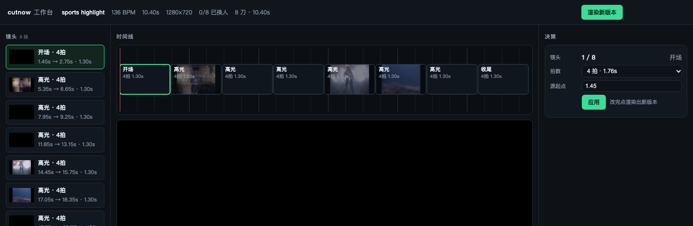

<div align="center">

# cutnow

**一个确定性的剪辑引擎：agent 能驱动，人能审查。**

[](https://github.com/jchen0102/cutnow/actions/workflows/ci.yml)
[](https://pypi.org/project/cutnow/)
[](https://pypi.org/project/cutnow/)
[](LICENSE)

[English](README.md) · [文档](docs/) · [内置解法](solutions/) · [Agent Skill](skill/SKILL.md) · [速查](dist/cutnow-lite.md)

</div>

> 素材在硬盘里，歌也选好了。每周你还是把同一条十五秒的片子重剪一遍，
> 而且没人说得清上一版到底好在哪。


```bash
pip install cutnow
cutnow doctor
cutnow run sports --source 比赛.mp4 --out 集锦.mp4
```

一条 10 秒的卡点集锦，片头片尾都在里面——没有时间线软件，没有渲染队列，没有手动对拍。

---

## 为什么不是"一键成片"

大部分工具给你一个**成片**：改一刀就得重来，也问不出"这一刀为什么在这"。

cutnow 给你一份 **EDL（剪辑清单）**——一个能读、能 diff、能改写的 JSON 时间线——外加一个
把它确定性渲染成视频的引擎。

| 常见工具 | cutnow |
|---|---|
| "AI 已为你智能剪辑" | 每一刀都有分数和理由 |
| 改一点要全部重生成 | 改一行，几秒重出 |
| 一个产品一套流程 | 新流程就是一份 JSON，引擎不动 |
| 只有成片 | 成片 + EDL + 质检报告 |

## 三个概念

```
解法 Solution   一份配方：用哪些算子、什么顺序、哪里必须人来确认
      ↓
算子 Op         一件确定的事：切段 / 卡点 / 打分 / 字幕 / 渲染 / 质检
      ↓
EDL             最终决策清单：每刀从原片哪一秒来、放哪、多长
```

就这三样：**解法是数据，算子是代码，EDL 是契约。**

## 内置解法

| 解法 | 输入 | 产出 | 依赖 |
|---|---|---|---|
| `film-montage` | 一段长片 + 音乐 | 约 20 秒卡点混剪，带片头片尾 | — |
| `sports-highlight` | 比赛素材 | 约 12 秒集锦，切点对齐镜头边界 | CLIP（可选，缺了自动降级） |
| `talk-highlight` | 口播视频 | 约 15 秒竖版切片 + 对齐字幕 | whisper.cpp（可选） |
| `mj-remake` | 原片 + 歌 | 卡点重剪 | — |

```bash
cutnow list
cutnow run film --source 电影.mov --out 混剪.mp4
cutnow run talk --source 口播.mp4 --out 切片.mp4
```

## 它怎么判断（而且让你看见）

一次真实运行，9 段公开素材，全程无人干预，**0 token**：

```
9 段素材 → 准入拒掉 4 段 → 出片 5 条 → 5/5 过质检 → 总耗时 86 秒
```

准入不是拍脑袋：抽帧后问 CLIP 模型"这看起来像不像比赛"。

```
sport_prob 0.994 → 通过（沙滩排球）
sport_prob 0.093 → 拒绝（街边人流）
```

选段再给每个候选窗口打分：**语义匹配 + 运动量 + 音频能量**，切点落在镜头边界上，然后渲染。
最后质检挡住所有"不能交付"的片子：

```
时长 10.40s ✓   黑帧 0 ✓   -12.6 LUFS ✓   字幕 12/16 字 ✓   清晰度 314 ✓
```



*可选的本地工作台（`cutnow serve`）：镜头、拍点网格、版本，以及与命令行同一份 EDL。*

## 写自己的解法

```bash
cutnow new my-recipe                      # 生成 solutions/my-recipe.solution.json
cutnow solution validate solutions/my-recipe.solution.json
cutnow run my-recipe --source in.mp4 --out out.mp4
```

```json
{
  "id": "my-recipe",
  "inputs": { "source": { "type": "video", "required": true } },
  "steps": [
    { "op": "analyze.standard", "params": { "features": "auto" } },
    { "op": "select.action", "gate": "confirm", "params": { "target_seconds": 12 } },
    { "op": "card.bookends", "params": { "title": "我的片子", "end": "cutnow" } },
    { "op": "render.edl", "params": { "out": "out/my-recipe.mp4" } },
    { "op": "qc.report", "params": {} }
  ]
}
```

未知算子、非法闸门在**校验阶段**就被拒——解法不可能执行你没审过的代码。
`"gate": "confirm"` 会在昂贵或不可逆的步骤前停下来等人点头。

## 算子

| 分组 | 算子 |
|---|---|
| 分析 | `analyze.standard` `analyze.media` |
| 选段 | `select.shots` `select.auto` `select.action` `select.semantic` |
| 语音 | `transcribe.whisper` `cut.by_sentence` |
| 音频 | `audio.chorus` `audio.from_clips` `audio.normalize` |
| 文字与画幅 | `subtitle.by_beat` `card.bookends` `frame.vertical` `cleanup.crop` |
| 输出 | `render.edl` `qc.report` `qc.source` |

## 安装

```bash
pip install cutnow          # 或 pipx install cutnow
cutnow doctor               # 自检 ffmpeg / 模型 / 字体，缺什么直接说要怎么装
```

ffmpeg 随包自带（`imageio-ffmpeg`），装完就能渲染。可选能力：

```bash
pip install "cutnow[clip]"     # 语义选段（约 600MB ONNX 模型）
pip install "cutnow[qc]"       # 清晰度指标（OpenCV）
python scripts/fetch_models.py --clip --whisper small
```

所有可选能力都**会降级**：没有 CLIP，选段退回运动+音频规则；没有 whisper，口播解法会明确告诉你缺什么，
而不是产出一个坏文件。

## 命令行

```
cutnow list                       # 列出解法与算子
cutnow run <solution>             # --source / --music / --out / --yes / --json
cutnow new <name>                 # 生成解法骨架
cutnow solution validate <path>
cutnow serve [--port 8799]        # 本地时间线工作台
cutnow doctor
```

## 目录结构

```
cutnow.py        命令行入口
core/            引擎：ops / solution / edl / render / qc / config
solutions/       内置解法（纯数据）
recipes/         旧的单文件 recipe 格式
workbench/       可选的本地 HTTP 时间线（仅标准库）
contrib/         可选集成（Harness 插件等）
docs/            图片与说明
```

## 限制

诚实清单，免得有人踩坑：

- **没有转场、调色、多轨。** 目前只有硬切，这是引擎现状。
- **换脸与人脸身份模块不包含**（合规原因）。接口留着，实现故意不给。
- **确定性，不等于有品味。** 质检保证片子能交付，不保证剪得好看。
- **不调云端 API。** 没有 key、没有按次计费、没有限流——但也没有生成式大模型。

## 路线图

- [x] EDL + 确定性渲染 + 质检闸门
- [x] 解法声明、校验与人工闸门
- [x] 素材准入与语义选段（CLIP）
- [ ] 提案层：`plan → diff → apply`，不再直接改 EDL
- [ ] 交叉淡化与简单调色
- [ ] 批量运行 + 汇总报告（目前放在 `contrib/`）

## 致谢

演示素材：*Tears of Steel* © Blender Foundation，[CC BY 3.0](https://creativecommons.org/licenses/by/3.0/)。
构建于 ffmpeg、[CLIP](https://github.com/openai/CLIP)（ONNX 版）与
[whisper.cpp](https://github.com/ggerganov/whisper.cpp)。

## 许可证

MIT，见 [LICENSE](LICENSE)。
